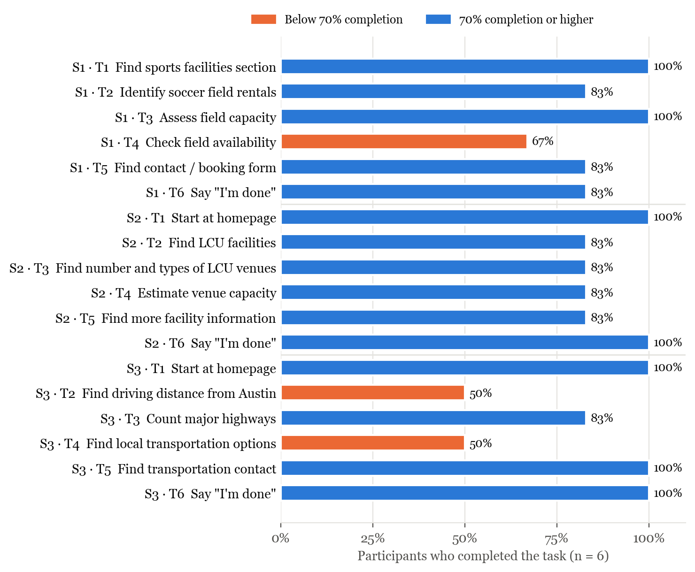
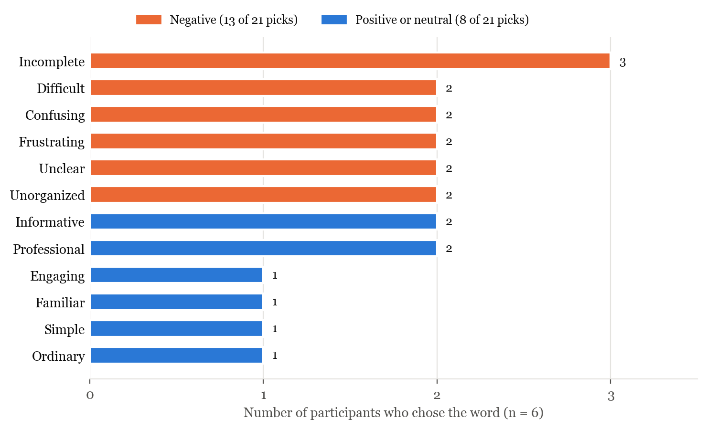

<!--
Figures are generated by make_figures.py (run it again if the data changes).
Styles (fonts, heading colors, table borders, cover/TOC page breaks) live in
usability-reference.docx.

Render: quarto render fowle_usabilityreport.qmd
Word will ask to "update the fields" when the .docx opens; click Yes to fill
in the Table of Contents.
-->



## Introduction

The purpose of this report is to provide information on user experience to the owners of the Lubbock Sports website based on user feedback from carefully designed testing scenarios. These testing scenarios involve activities that typical users of the website frequently attempt to do. By watching a diverse group of users use the website for its intended purpose while capturing rich feedback from these example users our goal is to assist the owners of the website to improve their website for future user ease of access.

The Lubbock Sports website provides potential visitors of Lubbock with information related to hosting sporting events of various types. Therefore, in this usability test the focus was to see how well users were able to use the website to find information related to scheduling sporting events as well as the usage of those services to schedule sporting events. Each of our six participants in the test met several conditions such as, they did not live within a 60-mile radius of Lubbock, they were between the ages of 25 to 65, and they attend or are involved in some way with sporting events.

Our results from testing include data on 3 scenarios each of which require the accomplishing of 6 sub-tasks by our users. Each task is conducted using the Lubbock Sports website. In each scenario we measured the time it took for each user to complete each task, the test facilitator recorded their observations on the users' actions and behaviors, any think-aloud comments the users made, any error or difficulties the users encountered, and whether or not the user completed the task.

We identified through our testing that users typically had very little issue with locating accurate data with regards to finding what facilities could host specific types of sporting events. However, when it came to actually finding the availability of those facilities for a given date, our test users posted mixed results. In addition to issues finding venue availability, users struggled to find accurate travel information such as travel distance and local transportation options within Lubbock.

## Purpose

The goal of this user experience testing is to test the design and layout of the Lubbock Sports website. We chose users who are typical users of such a website and gave them tasks commonly accomplished using a sports services website. We believe based on the tests conducted and the data that has resulted, the administrators of the Lubbock Sports website will be able to better adjust their site to ensure that users that use the site have positive outcomes.

## Methodology

Our usability testing had 3 main criteria for who would be considered an appropriate user for the site:

1.  Does not live within a 60-mile radius of Lubbock
2.  Is between the ages of 25 to 65
3.  Attends or is involved in sporting events

We conducted our tests using a video conferencing software that included screen-sharing tools which enabled the facilitator to guide participants through tasks as well as ask questions in real time. Our moderator briefed each participant on the Visit Lubbock website and instructed them that their goal is to evaluate the application.

Each participant signed an informed consent form acknowledging that participation is voluntary and that participation could cease at any time. They were also informed that the session was videotaped, but that their privacy and identity would be safeguarded. Participants also completed a pretest demographic and background information questionnaire.

We gave each participant a series of 3 scenarios each of which included 6 sub-tasks. At the beginning of each scenario-task the participant read aloud the task description from their printed copy and began the task. We measured time on task from the moment each participant finished reading the task aloud to when they declared they were done with a given task regardless of success or failure of that task.

The test facilitator encouraged participants to 'think-aloud'; the facilitator carefully recorded each comment made by users with regards to accomplishing their tasks while interacting with the website. The facilitator also recorded user behavior as well as system actions from the data log.

At the conclusion of all of the task scenarios, for each user, the facilitator asked participants about the site and their testing experience. Our interview included asking participants to select words from the "Product Reaction Cards" that described their experience.

## Results

### Task Completion Success Rate

<!-- TODO: explain what the tables show and add a paragraph describing the results. -->

| Participant | Task 1 | Task 2 | Task 3 | Task 4 | Task 5 | Task 6 |
|:-----------:|:------:|:------:|:------:|:------:|:------:|:------:|
| 1 | Yes | Yes | Yes | No | Yes | Yes |
| 2 | Yes | Yes | Yes | Yes | Yes | Yes |
| 3 | Yes | Yes | Yes | Yes | Yes | Yes |
| 4 | Yes | Yes | Yes | No | Yes | Yes |
| 5 | Yes | No | Yes | Yes | No | No |
| 6 | Yes | Yes | Yes | Yes | Yes | Yes |
| **Success** | **6** | **5** | **6** | **4** | **5** | **5** |
| **Completion Rate** | **100%** | **83%** | **100%** | **67%** | **83%** | **83%** |

: Scenario One task completion

| Participant | Task 1 | Task 2 | Task 3 | Task 4 | Task 5 | Task 6 |
|:-----------:|:------:|:------:|:------:|:------:|:------:|:------:|
| 1 | Yes | Yes | Yes | Yes | Yes | Yes |
| 2 | Yes | Yes | Yes | Yes | Yes | Yes |
| 3 | Yes | No | No | No | No | Yes |
| 4 | Yes | Yes | Yes | Yes | Yes | Yes |
| 5 | Yes | Yes | Yes | Yes | Yes | Yes |
| 6 | Yes | Yes | Yes | Yes | Yes | Yes |
| **Success** | **6** | **5** | **5** | **5** | **5** | **6** |
| **Completion Rate** | **100%** | **83%** | **83%** | **83%** | **83%** | **100%** |

: Scenario Two task completion

| Participant | Task 1 | Task 2 | Task 3 | Task 4 | Task 5 | Task 6 |
|:-----------:|:------:|:------:|:------:|:------:|:------:|:------:|
| 1 | Yes | No | No | No | Yes | Yes |
| 2 | Yes | No | Yes | No | Yes | Yes |
| 3 | Yes | No | Yes | Yes | Yes | Yes |
| 4 | Yes | Yes | Yes | No | Yes | Yes |
| 5 | Yes | Yes | Yes | Yes | Yes | Yes |
| 6 | Yes | Yes | Yes | Yes | Yes | Yes |
| **Success** | **6** | **3** | **5** | **3** | **6** | **6** |
| **Completion Rate** | **100%** | **50%** | **83%** | **50%** | **100%** | **100%** |

: Scenario Three task completion

{width=6.5in}

### Average Time on Task

<!-- TODO: explain what the tables show and add a paragraph describing the results.
     Note: times for tasks that were never completed run until the participant gave up. -->

| Participant | Task 1 | Task 2 | Task 3 | Task 4 | Task 5 | Task 6 |
|:-----------:|:------:|:------:|:------:|:------:|:------:|:------:|
| 1 | 0:42 | 1:13 | 0:20 | 4:01 | 0:22 | 0:09 |
| 2 | 0:06 | 0:14 | 2:14 | 1:19 | 0:05 | 0:01 |
| 3 | 1:31 | 0:30 | 0:49 | 0:02 | 0:11 | 0:02 |
| 4 | 0:05 | 0:34 | 1:37 | 2:14 | 0:07 | 0:01 |
| 5 | 1:01 | 1:10 | 0:36 | 1:08 | 1:28 | 1:48 |
| 6 | 1:12 | 0:24 | 0:15 | 0:49 | 0:04 | 0:03 |
| **Average** | **0:46** | **0:41** | **0:58** | **1:36** | **0:23** | **0:21** |

: Scenario One time on task (minutes:seconds)

| Participant | Task 1 | Task 2 | Task 3 | Task 4 | Task 5 | Task 6 |
|:-----------:|:------:|:------:|:------:|:------:|:------:|:------:|
| 1 | 0:02 | 1:44 | 2:14 | 1:07 | 1:04 | 0:02 |
| 2 | 0:05 | 1:35 | 0:09 | 2:37 | 1:08 | 0:01 |
| 3 | 0:02 | 3:31 | 2:13 | 2:53 | 4:01 | 0:02 |
| 4 | 0:04 | 3:24 | 0:14 | 1:34 | 0:35 | 0:13 |
| 5 | 0:05 | 1:12 | 1:38 | 0:36 | 0:07 | 0:05 |
| 6 | 0:03 | 1:02 | 0:18 | 0:23 | 0:05 | 0:02 |
| **Average** | **0:04** | **2:05** | **1:08** | **1:32** | **1:10** | **0:04** |

: Scenario Two time on task (minutes:seconds)

| Participant | Task 1 | Task 2 | Task 3 | Task 4 | Task 5 | Task 6 |
|:-----------:|:------:|:------:|:------:|:------:|:------:|:------:|
| 1 | 0:04 | 2:34 | 1:59 | 2:51 | 1:01 | 0:02 |
| 2 | 0:02 | 4:34 | 0:06 | 1:43 | 0:14 | 0:01 |
| 3 | 0:03 | 3:01 | 2:20 | 2:24 | 2:30 | 0:01 |
| 4 | 0:01 | 2:35 | 0:25 | 3:22 | 0:16 | 0:01 |
| 5 | 0:05 | 1:18 | 0:03 | 0:15 | 0:34 | 0:03 |
| 6 | 0:01 | 1:32 | 0:08 | 0:45 | 0:04 | 0:22 |
| **Average** | **0:03** | **2:36** | **0:50** | **1:53** | **0:46** | **0:05** |

: Scenario Three time on task (minutes:seconds)

### Website Ratings

<!-- TODO: explain what the table shows and add a paragraph describing the results. -->

| Participant | Overall Website Rating (1–5) |
|:-----------:|:----------------------------:|
| 1 | 2 |
| 2 | 1 |
| 3 | 3 |
| 4 | 2 |
| 5 | 4 |
| 6 | 4 |
| **Average Rating** | **2.67** |

: Overall website ratings from the debrief interview

{width=6.5in}

### Summary of Data

Of our test data there were three tasks that had both low completion (67% or less) as well as long completion times (greater than 1:30). They are scenario 1, task 4 (checking availability for soccer fields), scenario 3, task 2 (locate driving distance between Lubbock and Austin), and scenario 3, task 4 (finding information on local transportation options in Lubbock).

In addition to those three tasks we also found that scenario 2, task 2 (find information on facilities at Lubbock Christian University) had a high success rate (83%) but the average completion time was 2:05 which is quite high compared to other tasks.

All of the tasks that users had issues with shared a common theme: the required information to complete the task was either buried in the "Learn More" PDF or not available on the site at all.

| Task | Task Completion Rate | Average Task Completion Time |
|:----:|:--------------------:|:----------------------------:|
| 1 | 100% | 0:46 |
| 2 | 83% | 0:41 |
| 3 | 100% | 0:58 |
| 4 | 67% | 1:36 |
| 5 | 83% | 0:23 |
| 6 | 83% | 0:21 |

: Scenario One summary

| Task | Task Completion Rate | Average Task Completion Time |
|:----:|:--------------------:|:----------------------------:|
| 1 | 100% | 0:04 |
| 2 | 83% | 2:05 |
| 3 | 83% | 1:08 |
| 4 | 83% | 1:32 |
| 5 | 83% | 1:10 |
| 6 | 100% | 0:04 |

: Scenario Two summary

| Task | Task Completion Rate | Average Task Completion Time |
|:----:|:--------------------:|:----------------------------:|
| 1 | 100% | 0:03 |
| 2 | 50% | 2:36 |
| 3 | 83% | 0:50 |
| 4 | 50% | 1:53 |
| 5 | 100% | 0:46 |
| 6 | 100% | 0:05 |

: Scenario Three summary

## Discussion

Firstly, we found through testing that the website often unintentionally hides relevant information behind a "Learn More" button. Information such as venue lists, Lubbock Christian University (LCU) facilities, capacity, driving distances, highways and transportation are all pieces of information that are hidden behind a button that does not clearly signal what it contains. The tasks that depended on this PDF were the hardest for users to complete during testing. Finding LCU's facilities averaged 2:05, which made it the slowest task in scenario 2. Finding the driving distance and local transport options each only had a 50% completion rate (Figure 1). Several participants described clicking around until they found the button and Participant 4 asked, "Why was it hidden here?"

Second, we found that checking the availability of any of the listed venues is not possible on the site. Participants often expected to find a calendar or a page where they could book a venue for a given date. Participant 2 noted, "I would need to find a calendar... There's no calendar." Determining how to check availability (Scenario 1, Task 4) had a 67% completion rate and took the longest of any task in that scenario, with an average of 1:36. Nearly every participant fell back on the "Contact Us" form to complete the task which is why the contact form was repeatedly named as the easiest task. For event organizers, this means that planning on the site itself is nearly impossible without waiting for a staff member to respond.

Third, users had trouble getting to the Lubbock Sports page from the Visit Lubbock homepage. Participants 1 and 6 did not realize the drop-down menu was scrollable and both found the Sports link at the bottom of the page instead. Participant 3 was confused by a separate "sports" filter under the Events tab and was unsure why there were two sports related areas. That resulted in the first task in Scenario 1 averaging 0:46 compared to only a few seconds for the starting tasks of scenarios 2 and 3. Once on the sports website, facilities are organized only by sport. This became a problem for Participant 1 who wanted a "venues" or "facilities" list that was organized by location.

Additionally, the site does not include a search bar. Participants 2, 3 and 5 all looked for a search bar when they could not immediately find the information they were searching for. Participant 2 attempted to use their browser's built in search feature to find "Christian" but did not receive any results. This is likely because the information sits inside a PDF. During the debrief, Participant 2 stated, "There was no search. Most websites I expect to search." Search bars are a common quality of life feature on modern websites which is why we believe many users looked for one.

Travel information was also limited. Scenario 3 had the weakest results of the three scenarios, with two of its tasks completed by only half of the participants. Participants 1, 2, and 3 all said they would rather use Google Maps for travel distance and directions. Participant 6 found that the ground transportation section was so sparse that she wasn't actually sure if she completed the required task.

Several participants also noticed broken links, typos, and inconsistent data. For example, the LCU link led to a 404 error page so Participant 2 had to look up LCU's site using a search engine. Participant 3 found typos in the soccer PDF and raised accessibility issues related to users who rely on screen readers. Participant 5 noticed that venues don't always list the same details (one lists seat counts while another lists the number of courts). Furthermore, Participant 2 could not find capacity for every venue.

Users also took away several positives from the site. Participants 1, 3, 5, and 6 complimented the visual design of the site. Participants also appreciated the seating and capacity statistics once they were found, having all of the venues listed in one place, and how easy the contact form was to use.

## Recommendations

<!-- TODO: at least 3 recommendations, one paragraph each, highest priority first. -->

## Conclusion

<!-- TODO: one or two paragraphs on what participants found and what is key to the site's future success. -->
